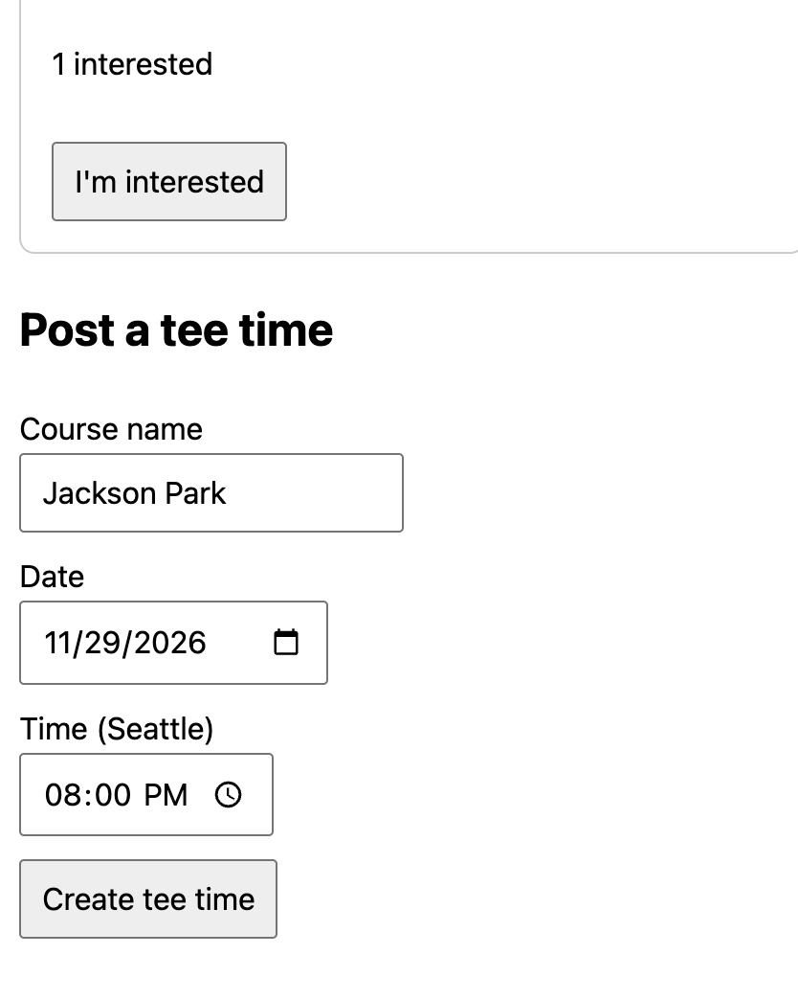
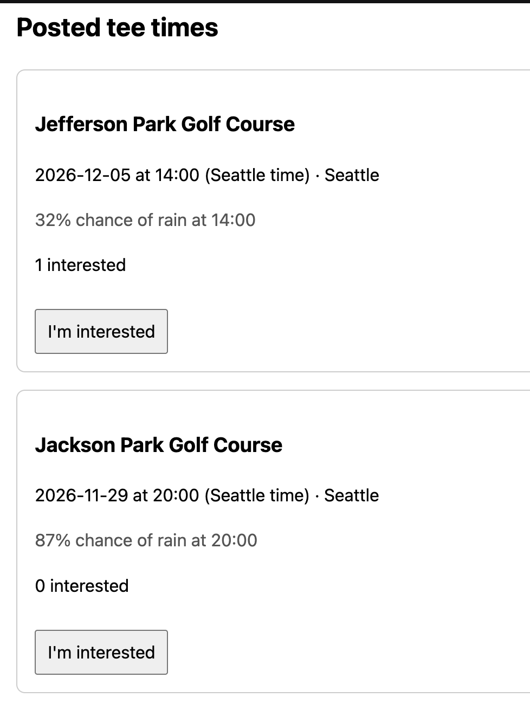
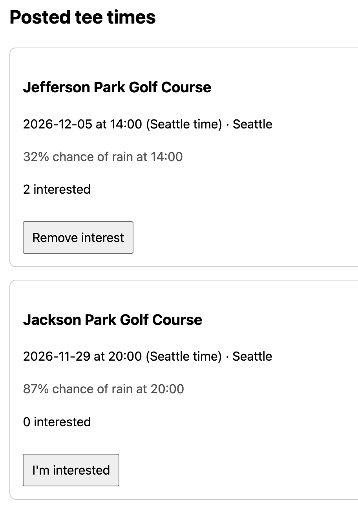
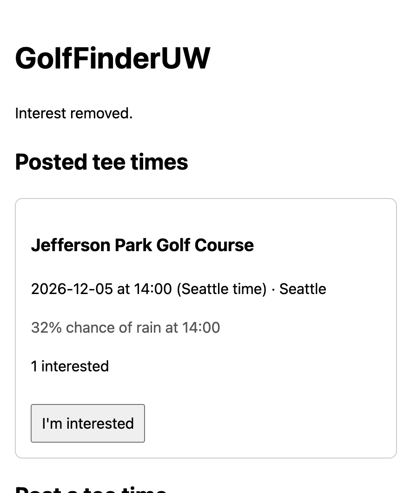

# GolfFinderUW — progress report

A user can post a tee time, express interest, remove interest, and see the saved interest count.

## Team flow diagram

(HW6/screenshots/team-flow.jpg)

The flow for one browse-page request, from the user opening the page through the GolfCore and Open-Meteo lookups to the rendered card. The left margin traces the failure paths: a GolfCore failure or an unknown course leaves no coordinates, so the card renders without a forecast.

## What works now

The local prototype runs end to end. A browser session identifies each student, and interest records are saved to `data/interests.json` with the P2 keys `interestId`, `postId` and `studentId`. The count on each card is calculated from those records rather than stored separately, and an open page picks up changes within two seconds without a reload.

GolfCore and Open-Meteo are connected in [api.py](api.py). Each card shows the course's city and the chance of rain at the tee time's hour, and falls back to "Weather unavailable" when the forecast cannot be reached.

Six automated checks pass in [tests/test_interest.py](tests/test_interest.py): saved interest survives a restart, two sessions stay separate, and the app handles missing files, broken JSON, invalid posts and missing form tokens. A browser check on November 24 confirmed posting through the form, adding and removing interest, and a second open page updating on its own.

## What's left for P3 (most important first)

1. **Real browse flow.** The post form is a temporary stand-in. P3 needs the date-based browse page, and each post should store a `courseId` instead of a typed course name, as planned in P2.
2. **GolfCore API key.** The key becomes required on December 4, 2026, the same day as our user test. Without a working key every card falls back to "Weather unavailable", so we register for one first and test it.
3. **User test with three golfers.** Run the test, write down what confuses people, and fix the clearest problems.
4. **Final screen recording.** Record the whole flow in under a minute once the browse page is in.
5. **Clean-up.** Short error messages the user can understand, and a check that two people posting at the same time do not overwrite each other's data.

## Design decision since P2

We use a browser session to identify each student instead of building accounts. It keeps the interest feature small while still letting two different browsers hold separate interests: a second click removes that session's existing record, and the count is calculated from the records rather than saved as a separate number. Tabs in the same browser share one identity, which is an accepted limit for this version.

## Test plan

Three UW student golfers will try the app at the UW Golf Club range meetup on Friday, December 4, 2026. The three participants are not confirmed by name yet.
---

Roger keeps his personal CC2 draft separately. The implementation is shared on the `roger/hw6-interest` branch; ownership and integration details are in [HANDOFF.md](HANDOFF.md).
